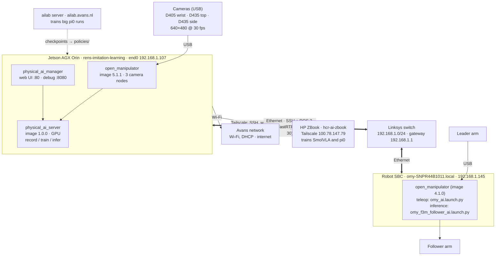

# Jetson robotis-omy: directory & network map

As of 2026-11-12 · Simon

## Overview

The Jetson AGX Orin `rens-imitation-learning` is the AI PC of the ROBOTIS OMY-F3M cell. It runs the three cameras, the Physical AI server and web UI, stores all datasets and policies, and starts the robot over a wired link to the robot SBC.

- **Path:** everything lives in `/home/rens/Code/robotis-omy` (`~/Code/robotis-omy` for user `rens`); there is no `/Code` at the root.
- **Platform:** Jetson AGX Orin, L4T R39 / JetPack 7, aarch64, 915 GB NVMe (234 GB free on 2026-11-12).
- **Not a git repo:** the top folder holds scripts, notes and data copies; only `open_manipulator/` and `physical_ai_tools/` are git checkouts.
- **Reference notes on the Jetson:** `UPDATE_PROCESS.md` (versions, update and rollback), `proces-log.txt` (training log), `policy-results.ods` (test results), and `~/Code/ROBOTIS OMY F3M setup.md` (manual setup).

## Directory map

Two git checkouts hold the software; `datasets/` and `policies/` are data copies kept outside git; the rest are scripts and notes. Sizes as of 2026-11-12.

```text
~/Code/robotis-omy/
├── open_manipulator/            git 4.1.4 – ROS 2 Jazzy robot packages; on the Jetson: camera nodes
│   └── docker/                  compose + container.sh for container "open_manipulator"
├── physical_ai_tools/           git 1.0.0 – record, train and run policies
│   ├── physical_ai_server/      ROS 2 node behind the web UI (config/omy_f3m_config.yaml)
│   ├── physical_ai_manager/     React web UI (http://localhost)
│   ├── physical_ai_bt/          behaviour trees (bt_bringup, trees/)
│   ├── physical_ai_interfaces/  ROS 2 msg/srv definitions
│   ├── rosbag_recorder/         C++ rosbag recording node
│   ├── lerobot/                 LeRobot library
│   │   └── outputs/train/       LIVE training output, 13 runs, 111 GB
│   └── docker/
│       ├── docker-compose.yml   containers physical_ai_server + physical_ai_manager
│       └── huggingface/         = /root/.cache/huggingface in the container
│           ├── lerobot/avanssmingaars/   LIVE recorded datasets, 1.5 GB
│           └── hub/                      base models (PaliGemma 3B, SmolVLM2 500M)
├── datasets/                    backup copies of 8 datasets, 1.8 GB
│   └── deeplink_lerobot_output  → symlink to huggingface/lerobot/avanssmingaars
├── policies/                    backup copies of 15 training runs, 173 GB
│   └── deeplink_lerobot_train   → symlink to lerobot/outputs/train
├── deeplink_lerobot_train/      real folder (not a link), 17 GB, one pi0 run
├── start_omy_teleop.sh          start cell for teleop and recording
├── start_omy_inference.sh       start cell for policy inference
├── stop_omy.sh / shutdown_omy.sh / reset_omy.sh
├── fix_physical_ai_cuda.sh      make CUDA work in physical_ai_server
├── relabel_single_task.py       rewrite the task text of a dataset
├── UPDATE_PROCESS.md  proces-log.txt  policy-results.ods
└── paligemma_with_expert.py.orig   original of a patched pi0 file
```

Siblings in `~/Code` (outside scope): `_archive/`, `luxonis-oak-camera/` and `ROBOTIS OMY F3M setup.md`.

## Applications

The cell runs as three Docker containers on the Jetson plus one on the robot SBC; the shell scripts in the top folder start and stop all of them in the right order.

| Directory | Runs as (container, image) | What it can do |
| --- | --- | --- |
| `open_manipulator/` | `open_manipulator`, `robotis/open-manipulator:5.1.1`; the 4.1.4 checkout is mounted over the image source | ROS 2 Jazzy packages for the OMY arm: bringup launch files, URDF description, MoveIt config, GUI, teleop, collision checking and custom ros2 controllers (gravity compensation, spring actuator). **On the Jetson it only publishes the three RealSense cameras** (wrist D405, top D435, side D435, 640×480 at 30 fps). The same repo on the robot SBC drives the arm. |
| `physical_ai_tools/physical_ai_server/` | `physical_ai_server`, `robotis/physical-ai-server:1.0.0` (GPU, CUDA fixed by `fix_physical_ai_cuda.sh`) | ROS 2 node behind the web UI: records LeRobot datasets from the cameras and joint states, starts training, and runs a trained policy on the robot (inference). Camera topics are set in `config/omy_f3m_config.yaml`. Started with the alias `ai_server` inside the container. |
| `physical_ai_tools/physical_ai_manager/` | `physical_ai_manager`, `robotis/physical-ai-manager:1.0.0` | React web UI on `http://localhost` to pick the task, record episodes, train and start inference; debugging on `http://localhost:8080`. |
| `physical_ai_tools/lerobot/` | inside `physical_ai_server` (`/opt/venv`) | LeRobot library: dataset format, training script and policies (ACT, Diffusion, pi0, pi0-FAST, SmolVLA, TD-MPC, VQ-BeT, SAC). Training output goes to `outputs/train/`. |
| `physical_ai_tools/physical_ai_bt/`, `physical_ai_interfaces/`, `rosbag_recorder/` | built in `physical_ai_server` | Behaviour-tree runner, the ROS 2 messages and services between UI and server, and a rosbag recording node. |

Scripts in the top folder (all run on the Jetson, robot steps over SSH):

| Script | What it does |
| --- | --- |
| `start_omy_teleop.sh` | Starts cameras, AI server and the robot container, then launches `omy_ai.launch.py` on the robot: leader arm drives the follower, ready for recording. Stops a running inference first. |
| `start_omy_inference.sh` | Same start, but launches `omy_f3m_follower_ai.launch.py ros2_control_type:=omy_f3m_smooth` on the robot: no leader arm, the policy drives the follower. |
| `stop_omy.sh` | Stops the robot container and the three Jetson containers. |
| `shutdown_omy.sh` | Shuts down the robot SBC (`shutdown now` over SSH). |
| `reset_omy.sh [s]` | Moves the follower to the ready pose in 10 s (or the given seconds). |
| `fix_physical_ai_cuda.sh` | Drops the CUDA 12.8 compat library from `LD_LIBRARY_PATH` and installs torch 2.9.1+cu130; needed after every recreation of `physical_ai_server`. |
| `relabel_single_task.py` | Rewrites the task instruction of a recorded dataset to one task. |

## Datasets and policies

The containers read and write only the **live** folders inside `physical_ai_tools/`; `datasets/` and `policies/` are manual backup copies outside the git checkout, so a `git reset --hard` or a re-clone cannot wipe them.

| Data | Live folder (host) | Same folder inside `physical_ai_server` | Backup copy |
| --- | --- | --- | --- |
| Recorded datasets | `physical_ai_tools/docker/huggingface/lerobot/avanssmingaars/` | `/root/.cache/huggingface/lerobot/avanssmingaars/` | `datasets/omy_f3m_*` |
| Trained policies | `physical_ai_tools/lerobot/outputs/train/<run>/` | `/root/ros2_ws/src/physical_ai_tools/lerobot/outputs/train/<run>/` | `policies/<run>/` |
| Base models (PaliGemma 3B for pi0, SmolVLM2 500M for SmolVLA) | `physical_ai_tools/docker/huggingface/hub/` | `/root/.cache/huggingface/hub/` | none |

### Datasets

All are LeRobot datasets at 30 fps, recorded under the Hugging Face user `avanssmingaars`.

| Dataset (`omy_f3m_…`) | Episodes | Cameras | Live | Backup |
| --- | --- | --- | --- | --- |
| `block placing II-pos6` | 19 | wrist, top, side | yes | yes |
| `block placing II-pos5` | 20 | wrist, top, side | yes | yes |
| `block placing II-pos4` | 20 | wrist, top, side | yes | yes |
| `block placing II-pos3` | 15 | wrist, top, side | yes | yes |
| `block placing II-pos2` | 14 | wrist, top, side | yes | yes |
| `block placing II` (pos 1) | 40 | wrist, top, side | yes | yes |
| `Block placing` | 52 | wrist, top, side | yes | yes |
| `Block picking` | 3 | wrist, top, side | yes | no |
| `Object placement` | 84 | wrist, top | no | yes |

The live folder also holds two hidden recovery folders (`.backup_bin_placing_ep87_…`, `.backup_II-pos2_ep2_…`).

### Policies

Each run folder usually holds `checkpoints/005000`, `010000`, `015000`, `020000` (a checkpoint every 5k steps) plus a `last` link; the model to load is `checkpoints/<step>/pretrained_model`.

| Policy family | Runs | Size per run | Where |
| --- | --- | --- | --- |
| SmolVLA (`smolvla_block_placing_…`) | 9 | about 5 GB | live and backup |
| pi0 (`pi0_block_placing_…`) | 4 | 17–33 GB | live and backup |
| pi0 trained on the ailab server (`pi0_block_placing_II_pos1-5_…`, `…_pos1-6_…`) | 2 | 14–17 GB | **backup only** |

- The web UI only sees the live folder, because only `physical_ai_tools/` is mounted into the container. To run the two ailab pi0 runs, copy them from `policies/` into `physical_ai_tools/lerobot/outputs/train/` first.
- Training settings, instructions and results per run are in `proces-log.txt` and `policy-results.ods`.
- Open question: the top-level `deeplink_lerobot_train/` is a real 17 GB folder with checkpoints of `pi0_block_placing_II_pos1-5_bs64accum_decay20k`, probably a duplicate of the copy in `policies/`. Delete it or turn it into a link?

## Symbolic links

Two hand-made "deeplinks" point from the backup folders into the live folders, so the live data is one click away from the backups; all other links are made automatically by LeRobot or Hugging Face.

| Link | Points to | Made by |
| --- | --- | --- |
| `datasets/deeplink_lerobot_output` | `/home/rens/Code/robotis-omy/physical_ai_tools/docker/huggingface/lerobot/avanssmingaars` (absolute) | by hand, `ln -s` |
| `policies/deeplink_lerobot_train` | `/home/rens/Code/robotis-omy/physical_ai_tools/lerobot/outputs/train` (absolute) | by hand, `ln -s` |
| `<run>/checkpoints/last` (in live and backup) | `020000` (relative) | LeRobot, at every checkpoint save |
| `smolvla_block_placing_bs32_decay20k/checkpoints/last` | `005000` | re-pointed by hand: this run did best at 5k steps |
| `docker/huggingface/hub/*/snapshots/*` | `../../blobs/<hash>` | Hugging Face cache |

To recreate the two deeplinks:

```bash
cd ~/Code/robotis-omy
ln -s /home/rens/Code/robotis-omy/physical_ai_tools/docker/huggingface/lerobot/avanssmingaars datasets/deeplink_lerobot_output
ln -s /home/rens/Code/robotis-omy/physical_ai_tools/lerobot/outputs/train policies/deeplink_lerobot_train
```

To point `last` at another checkpoint: `ln -sfn 010000 checkpoints/last` inside the run folder.

The containers do not use symlinks. They see the checkouts through Docker bind mounts:

| Host folder | Container | Mounted at |
| --- | --- | --- |
| `physical_ai_tools/` | `physical_ai_server` | `/root/ros2_ws/src/physical_ai_tools/` |
| `physical_ai_tools/docker/huggingface/` | `physical_ai_server` | `/root/.cache/huggingface/` |
| `physical_ai_tools/docker/workspace/` | `physical_ai_server` | `/workspace` |
| `open_manipulator/` | `open_manipulator` | `/root/ros2_ws/src/open_manipulator/` |
| `open_manipulator/docker/workspace/` | `open_manipulator` | `/workspace` |

The top-level `deeplink_lerobot_train/` has a link's name but is a real folder (see the open question under Policies).

## Link with the robot PC

The Jetson and the robot SBC share a wired subnet, 192.168.1.0/24, through the Linksys switch. The Jetson controls the robot over **SSH** (start, stop, launch) and exchanges all robot data over **ROS 2 DDS** (FastRTPS, domain 30).

| | Jetson (AI PC) | Robot SBC |
| --- | --- | --- |
| Hostname | `rens-imitation-learning` | `omy-SNPR44B1011` (`.local`) |
| Wired address | `end0` 192.168.1.107/24 | 192.168.1.145 |
| Other networks | Wi-Fi `wlP1p1s0` (Avans, DHCP, internet); Tailscale 100.118.184.83 | none: no internet, no DNS |
| OS | L4T R39 / JetPack 7 | Yocto Poky scarthgap |
| Containers | `open_manipulator` (cameras), `physical_ai_server`, `physical_ai_manager` | `open_manipulator` (arm control), from `/data/docker/open_manipulator` |
| Hardware on it | 3 RealSense cameras over USB | follower arm; leader arm over USB |

### How the link is made

1. **Name resolution:** `/etc/hosts` on the Jetson maps `omy-SNPR44B1011.local` to 192.168.1.145, so it does not depend on mDNS. The TLDR of `ROBOTIS OMY F3M setup.md` says 192.168.0.145; the working address is 192.168.1.145.
2. **SSH:** the scripts run `ssh root@omy-SNPR44B1011.local …` with key login (no password prompt). Over SSH they `docker start open_manipulator`, launch `omy_ai.launch.py` (teleop) or `omy_f3m_follower_ai.launch.py` (inference), stop the container and shut the SBC down.
3. **ROS 2:** all four containers use `network_mode: host`, so DDS discovery runs straight over `end0`. Everyone uses `ROS_DOMAIN_ID=30` and `RMW_IMPLEMENTATION=rmw_fastrtps_cpp`; the start scripts force FastRTPS in the Jetson containers' `~/.bashrc` because the robot image has no Zenoh.
4. **Updates:** the SBC has no internet, so images go over the same link: `docker save … | ssh root@omy-SNPR44B1011.local "docker load"` (see `UPDATE_PROCESS.md`).

### Data over the link

| Topic | From → to | Rate |
| --- | --- | --- |
| `/camera1/cam_wrist/color/image_rect_raw/compressed` | Jetson cameras → AI server | about 30 Hz |
| `/camera2/cam_top/color/image_raw/compressed` | Jetson cameras → AI server | about 30 Hz |
| `/camera3/cam_side/color/image_raw/compressed` | Jetson cameras → AI server | about 30 Hz |
| `/joint_states` | robot → AI server | about 400 Hz |
| `/leader/joint_trajectory` | leader arm (teleop) or AI server (inference) → follower | about 300 Hz in teleop |

To open the UI from another machine, reach the Jetson over Tailscale (for example from the ZBook `hcr-ai-zbook`, 100.78.147.79) and browse to port 80. Moving the robot to open_manipulator 5.x switches the whole cell to Zenoh (router on port 7447); `UPDATE_PROCESS.md` section 7 has the steps.

## Network diagram



The thick lines are the wired robot subnet; everything the robot does goes over that one cable. Dashed lines are indirect: checkpoints copied by hand from the ailab server.

An editable Excalidraw version of this picture is in [`omy-network.excalidraw`](omy-network.excalidraw) (open it at excalidraw.com or with the Excalidraw plugin for VS Code or Obsidian).
